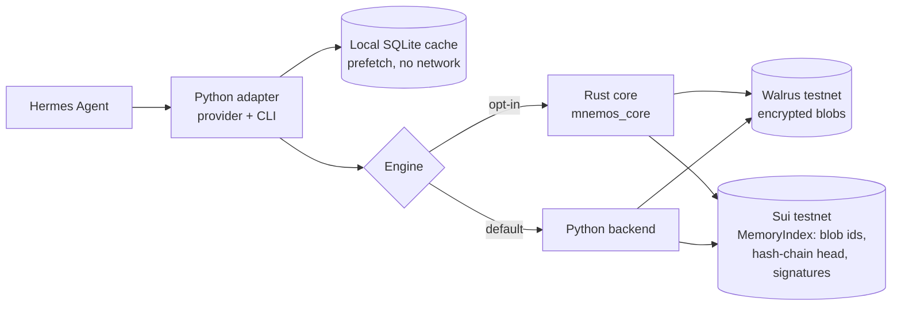

<div align="center">


# Mnemos

**Sovereign memory for [Hermes Agent](https://github.com/NousResearch/hermes-agent): encrypted on your machine, stored on Walrus, indexed on Sui, restorable anywhere.**

[](LICENSE)
[](https://www.python.org/)
[](https://github.com/NousResearch/hermes-agent)
[](https://sui.io/)
[](https://www.walrus.xyz/)
[](https://mnemos.rest)

**[mnemos.rest](https://mnemos.rest)** · [Quickstart](#quickstart) · [Verify the history](#verify-the-history) · [Documentation](#documentation) · [Network disclosure](#network-disclosure)

</div>

---

Mnemos is a memory provider plugin for Hermes Agent. Facts are encrypted on the machine that writes them, stored as ciphertext blobs on Walrus testnet, and indexed by a Sui object you own. Another machine restores that memory with the same user secret and the Sui object id.

## Why Mnemos

- **Yours alone.** XChaCha20-Poly1305 encryption with keys derived from `MNEMOS_SECRET`. Plaintext and the secret never leave the machine.
- **Portable.** Wipe a profile or switch machines: `hermes mnemos restore` rebuilds the local cache from Walrus and Sui.
- **Verifiable.** Every snapshot is hash-chained and Ed25519-signed. `hermes mnemos history --verify` checks the whole chain, without the secret.
- **Available.** Reads come from the same Sui fullnode that executes writes. GraphQL is only a fallback, used when it is on testnet and within 100 checkpoints of the fullnode; a stale indexer is refused instead of trusted. [Why](docs/en/architecture.md#reads-and-availability).
- **Fast.** Prefetch and recall read a local SQLite cache and never touch the network.
- **Works out of the box.** A pure Python backend handles encryption and chain writes. The Rust core is optional and opt-in, and both produce the same ciphertext, content hash, and signature.

## Architecture



Details: [architecture](docs/en/architecture.md) · [verifiable history](docs/en/verifiable-history.md).

## Quickstart

Requires Hermes Agent 0.23.1 or newer and Python 3.11 or newer. Full steps are in the [installation guide](docs/en/installation.md).

**1. Install the plugin** (pin a 40-character commit SHA):

```bash
hermes plugins install https://github.com/bugnarokdev/mnemos.git --ref <commit-sha> --yes-deps --enable
```

Or put this repository at `$HERMES_HOME/plugins/mnemos`, set `memory.provider: mnemos` in `$HERMES_HOME/config.yaml`, and run `hermes plugins validate --install-deps`. That installs the Python dependencies, including the gRPC client that writes to Sui and Walrus.

**2. Set your secret** in `$HERMES_HOME/.env` (Hermes reads it with `get_secret`; Mnemos does not open `.env` itself):

```bash
MNEMOS_SECRET=choose-a-long-passphrase
```

**3. Create your MemoryIndex** on Sui testnet (funds gas from the faucet, publishes the Move package, creates the object):

```bash
cd move/MemoryIndex
sui move build --dump-bytecode-as-base64 > /tmp/mnemos-bytecode.json
hermes mnemos init --bytecode /tmp/mnemos-bytecode.json
```

**4. Restore on another machine** with the same `MNEMOS_SECRET`:

```bash
hermes mnemos restore --object-id 0x<your-memory-index>
```

Only the object id is needed: the package id is read from the object's type, so `flush` works afterwards without `init`.

## Verify the history

`hermes mnemos history` lists every snapshot in the MemoryIndex. With `--verify` it downloads each blob from Walrus, recomputes its content hash and the link to the previous one, checks the Ed25519 signature, prints `OK` or `BROKEN` per version, and exits non-zero on any failure. It needs no secret.

```text
$ hermes mnemos history --verify
MemoryIndex 0x40028382ba48edaff90240696fb0441854046d9bee10195d296d2046a72668e3  pubkey c5f2488e608132c3
v1    OK     03053bacf1305209  blob ymHOBfSei9ECmnM_CoA-4Q2oLtTX3tYgVgvN4Hngxiw
v2    OK     799a8745d1d77c62  blob 31Wm7ToeEUOP0GWGFn3_UjinT02gtLuJ4Rm2mnF0HVg
OK: 2 versions verified
```

## Commands

| Command | What it does |
| --- | --- |
| `hermes mnemos status` | Show the local store, the chain head, and the active backend |
| `hermes mnemos doctor` | Check the secret, local store, Walrus, and Sui |
| `hermes mnemos init --bytecode <json>` | Fund the gas key, publish MemoryIndex, create the object |
| `hermes mnemos flush` | Commit the outbox to Walrus and Sui |
| `hermes mnemos restore [--object-id <id>]` | Rebuild the local cache from a MemoryIndex |
| `hermes mnemos history [--verify] [--json]` | List the snapshot history, or check every version |

`scripts/demo.sh` runs the full loop: write a fact on profile A, publish an encrypted blob and update the Sui index, wipe that profile, restore into profile B, and check that Hermes prefetch recalls the fact. It also prints local prefetch latency.

## Native core (optional)

By default Mnemos uses the Python backend and downloads nothing. Set `MNEMOS_NATIVE_AUTO=1` to opt in to the native wheel: it comes only from this repository's official GitHub release and must match a sha256 pinned in `mnemos/native_wheel.py`. The wheels are built and attested by the public GitHub Actions workflow; nothing binary is committed. `hermes mnemos doctor` reports which backend is active and why. See [installation](docs/en/installation.md#native-core).

## Documentation

English and French are kept in sync.

| Topic | English | Français |
| --- | --- | --- |
| Overview | [overview](docs/en/overview.md) | [présentation](docs/fr/overview.md) |
| Installation | [installation](docs/en/installation.md) | [installation](docs/fr/installation.md) |
| Configuration | [configuration](docs/en/configuration.md) | [configuration](docs/fr/configuration.md) |
| Architecture | [architecture](docs/en/architecture.md) | [architecture](docs/fr/architecture.md) |
| Security and encryption | [security](docs/en/security.md) | [sécurité](docs/fr/security.md) |
| Restore and migration | [restore](docs/en/restore.md) | [restauration](docs/fr/restore.md) |
| Verifiable history | [verifiable history](docs/en/verifiable-history.md) | [historique vérifiable](docs/fr/verifiable-history.md) |
| Sui and Walrus testnet | [deployment](docs/en/deployment.md) | [déploiement](docs/fr/deployment.md) |
| Troubleshooting | [troubleshooting](docs/en/troubleshooting.md) | [dépannage](docs/fr/troubleshooting.md) |

## Security at a glance

- `MNEMOS_SECRET` is read only through Hermes `get_secret` and never leaves the process. Argon2id (64 MiB, 3 passes) stretches it, then HKDF-SHA256 derives the encryption key, the snapshot signing key, and (unless `MNEMOS_SUI_PRIVATE_KEY` is set) the Sui gas key. Indexes created before 0.2.2 restore read-only.
- Payloads sent to Walrus are ciphertext. The Sui object stores blob ids, hashes, and signatures, not plaintext.
- The MemoryIndex only accepts an append that links to the current head, increments the version, and carries a valid signature from the key it was created with.
- This release targets **Sui testnet and Walrus testnet** only. Testnet SUI and WAL have no value. Before signing anything, Mnemos checks that `sui_rpc` reports the Sui testnet chain id and refuses otherwise, including on errors and timeouts.

Full details: [security](docs/en/security.md).

## Network disclosure

When a flush, checkpoint, restore, init, doctor, or history runs, Mnemos calls:

- Walrus testnet publisher `https://publisher.walrus-testnet.walrus.space` (`PUT /v1/blobs`)
- Walrus testnet aggregator `https://aggregator.walrus-testnet.walrus.space` (`GET /v1/blobs/<id>`)
- Sui testnet gRPC `https://fullnode.testnet.sui.io:443` (writes and reads)
- Sui testnet GraphQL `https://graphql.testnet.sui.io/graphql` (freshness check, and reads only when the fullnode read fails)
- Sui testnet faucet `https://faucet.testnet.sui.io` during `hermes mnemos init` only
- Opt-in only: the native wheel from `https://github.com/bugnarokdev/mnemos/releases/download/mnemos-native-v0.2.3/` when `MNEMOS_NATIVE_AUTO=1` and `mnemos_core` is not already installed. The URL is fixed and the wheel must match a sha256 pinned in `mnemos/native_wheel.py`; nothing else is fetched. Off by default.

Prefetch and recall do not use the network. There is no telemetry.

## License

MIT. See [LICENSE](LICENSE). Built by BugNaRok ([@bugnarokdev](https://github.com/bugnarokdev)).
