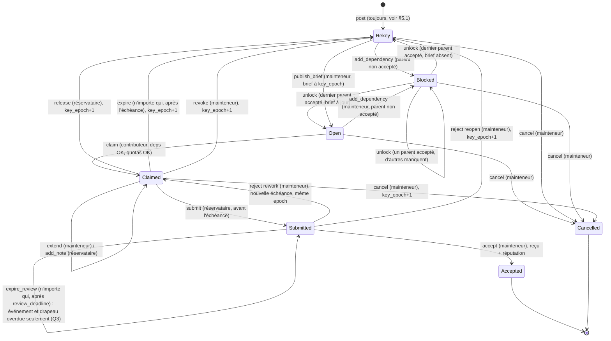

# Mnemos : tableau de missions coop (BETA) : document de conception

> **BETA (testnet preview).** Ce document décrit une fonctionnalité en cours. Depuis P1,
> le package `move/MissionBoard` existe et est testé **en local seulement** : il n'est
> pas publié sur testnet, et il n'y a pas encore de commande `board` (§19).
> Version v1 (phase P0) : les 13 questions ouvertes de la v0 sont tranchées, voir §18.
> Correction v1 : un seul chef de projet (mainteneur) par tableau, rôle transmissible
> en deux étapes (§4.5, décision C1).
> Tout ce qui suit vise Sui testnet, Walrus testnet et les serveurs de clés Seal de testnet
> de Mysten. Les formats, noms et coûts sont provisoires. Les coûts en gas sont des
> **estimations**, pas des mesures.

| | |
| --- | --- |
| Statut | design v1 (P0), questions ouvertes tranchées le 13 novembre 2026, puis correction « chef de projet unique » le même jour ; P1 (package Move et tests locaux) fait, voir §19 |
| Branche | `preview/board`, partant de `preview/seal` `b3508ac` (Q1) ; `main` n'est pas concerné |
| Base | Mnemos `preview/seal` `b3508ac` ; sui-seal-client `v0.2.0` (`da579f6`) |
| Sources lues | `native/src/share.rs`, `mnemos/py_share.py`, `move/SharedSpace/sources/space.move`, `docs/en/preview-seal.md`, `docs/en/test-report-preview-seal.md` ; dans sui-seal-client : `move/allowlist`, `move/policies` (`timelock`, `private_data`, `subscription`) |
| Hors périmètre de ce document | publication Move, push, release, mainnet |

---

## 1. Résumé

Un **tableau de missions** est un objet Sui partagé (`Board`) qui référence des missions,
chacune étant un objet Sui partagé (`Mission`). Le **chef de projet** (mainteneur unique
du tableau, celui qui définit les missions) publie une mission avec un
brief chiffré par Seal. Un contributeur, humain ou agent Hermes, la **réserve** (claim)
par une transaction : la réservation est exclusive et inscrite sur la chaîne. Tant que la
réservation est active et non expirée, les serveurs de clés Seal acceptent de donner au
réservataire, et à lui seul en plus du chef de projet, les clés du brief de cette mission.
Le contributeur livre un résultat chiffré, signé par sa transaction de livraison. Le
chef de projet l'accepte ou le refuse. Il peut transmettre le projet à un participant
(typiquement un contributeur très actif), qui devient alors le nouveau chef de projet. Une mission acceptée débloque les missions qui en
dépendent, et leurs réservataires peuvent alors lire le résultat livré. Une réservation
expirée ne donne plus de clés, puis repasse à l'état ouvert. Chaque mission acceptée
laisse un reçu non transférable, base d'une réputation vérifiable mais limitée. Les
primes en SUI viennent plus tard, sous forme d'escrow.

Le point le plus important, à garder en tête partout : **Seal ne reprend pas une clé
déjà donnée.** Une expiration ou une révocation coupe l'accès aux clés futures, pas aux
données déjà déchiffrées ni aux clés déjà obtenues. Le design limite la portée de
chaque clé (identifiants par mission, par réservation et par type de contenu) et fait
tourner le contexte après chaque révocation ; il ne prétend pas faire plus.

## 2. Objectifs et non-objectifs

### Objectifs (pour la BETA)

1. Un tableau public de missions, lisible par tous (titre, labels, état, dépendances,
   réservataire, échéance), comme une liste d'issues.
2. Une réservation exclusive sur la chaîne : deux contributeurs ne peuvent pas détenir la
   même mission en même temps ; l'ordre est fixé par le consensus Sui.
3. Un contexte privé par mission : brief et notes chiffrés par Seal, accessibles aux
   au chef de projet et au réservataire actif uniquement.
4. Une livraison attribuable : le résultat est référencé sur la chaîne (blob Walrus,
   sha256, auteur, horodatage) par une transaction signée par le réservataire.
5. Une validation humaine (ou par l'adresse du chef de projet) explicite : rien n'est accepté
   automatiquement.
6. Un graphe de dépendances (DAG) : une mission bloquée s'ouvre quand ses parents sont
   acceptés, et son réservataire peut lire les résultats des parents.
7. Une expiration fondée sur l'horloge Sui (`0x6`), effective côté Seal dès l'échéance.
8. Une réputation non transférable, par tableau, qui dit exactement ce qu'elle prouve.
9. Deux implémentations à parité, Rust (`seal` feature) et Python (bindings sui-seal-client
   v0.2.0), avec le même JSON et les mêmes appels on-chain, comme pour `share`.
10. Zéro erreur sur deux suites complètes consécutives avant toute demande de push.

### Non-objectifs (BETA)

- Pas de mainnet, pas de revue de sécurité faite à ce stade (elle est un prérequis du
  mainnet, voir la roadmap existante).
- Pas d'arbitrage ni de résolution de litiges : le chef de projet décide seul.
- Pas de co-mainteneurs : un seul chef de projet par tableau ; le rôle se transmet, il ne
  se partage pas (décision C1).
- Pas de retrait des données déjà lues par un ancien réservataire (impossible avec Seal).
- Pas de preuve de qualité du travail, ni d'identité réelle des contributeurs.
- Pas de primes en SUI dans les premières phases (escrow esquissé en §11, phase tardive).
- Pas de fusion automatique dans la mémoire personnelle : comme pour `share`, le
  contenu du tableau vit dans un cache séparé et ne touche ni la `MemoryIndex` ni
  `config.json`.
- Pas d'exécution du code livré par Mnemos : relire et exécuter reste la responsabilité
  du mainteneur.
- Pas de modification de `move/SharedSpace` ni du package allowlist : le tableau est un
  package Move séparé.

## 3. Acteurs

| Acteur | Identité on-chain | Peut |
| --- | --- | --- |
| **Chef de projet (mainteneur)** | une seule adresse par tableau : `Board.lead`, qui détient la `BoardAdminCap` valide (`Board.admin_cap_id`) ; adresse simple ou multisig Sui. Au départ, le créateur du tableau | définir et publier les missions, modifier tant que la mission est ouverte, prolonger, accepter, refuser, révoquer, annuler, déclarer des dépendances, republier le brief, changer les paramètres, geler le tableau, proposer ou annuler la transmission du projet (§4.5) |
| **Successeur désigné** | l'adresse de `Board.pending_lead`, pendant une transmission en cours | accepter la transmission et devenir chef de projet ; aucun autre droit avant l'acceptation |
| **Contributeur humain** | une adresse Sui (clé `MNEMOS_SHARE_KEY_FILE` ou adresse Mnemos du profil) | réserver, travailler, livrer, abandonner |
| **Contributeur agent** | adresse Sui propre à l'agent Hermes (une clé dédiée par agent recommandée) | les mêmes actions que l'humain, sous les garde-fous du §13 |
| **Ancien chef de projet** | toute adresse qui a transmis le rôle | plus aucun droit de chef de projet ; participant normal (peut réserver ensuite, aux règles normales) |
| **N'importe qui** | toute adresse | lire l'état public, déclencher `expire` sur une réservation échue, déclencher `unlock` d'une dépendance satisfaite |
| **Serveurs de clés Seal** | `mysten-testnet-1/2` ou le comité Mysten, comme `share` | évaluer `seal_approve_*` par dry-run sur leur nœud et donner ou refuser les clés |

Un agent et un humain sont **indiscernables sur la chaîne** : une adresse est une adresse.
Le champ optionnel `operator` (§4) permet à un agent de déclarer l'humain qui le pilote ;
c'est une déclaration, pas une preuve. Pour la BETA, elle reste déclarative : aucune
contresignature on-chain par l'humain (décision Q6, §18).

## 4. Modèle d'objets Move

Nouveau package proposé : `move/MissionBoard`, module `mnemos_board::board`, édition 2024,
licence MIT. Il ne dépend que de `sui` et `std` (pas de l'allowlist : le contrôle d'accès
Seal est propre au tableau). Constantes de borne pour rester sous la taille maximale d'un
objet et sous les limites de calcul des dry-runs Seal.

### 4.1 Objets et structures

```move
/// Objet partagé. Paramètres et chef de projet. Muté rarement :
/// création de mission, transmission du projet, acceptation (réputation).
public struct Board has key {
    id: UID,
    version: u64,                       // garde de version (motif de subscription.move)
    name: String,                       // <= 64 octets
    creator: address,                   // créateur du tableau (info, ne change jamais)
    lead: address,                      // chef de projet actuel, seul mainteneur
    admin_cap_id: ID,                   // seule BoardAdminCap valide, détenue par `lead`
    pending_lead: Option<address>,      // transmission en cours (une seule à la fois)
    next_seq: u64,                      // numéro de mission, croissant
    frozen: bool,                       // plus de nouvelles missions ni de claims
    params: BoardParams,
    reputation: Table<address, RepStats>,
}

public struct BoardParams has store, copy, drop {
    default_claim_ttl_ms: u64,          // ex. 72 h
    max_claim_ttl_ms: u64,              // borne des prolongations, ex. 14 j
    review_window_ms: u64,              // délai de relecture d'une livraison, ex. 7 j
    max_active_claims: u64,             // claims simultanés par adresse, ex. 2
    reclaim_cooldown_ms: u64,           // un ancien réservataire expiré attend avant de reprendre la même mission
    min_reputation_to_claim: u64,       // 0 par défaut ; par mission possible
}

/// Capacité du chef de projet. `key` sans `store` : seul ce module la transfère,
/// pour que `Board.lead` et le détenteur de la cap ne puissent pas diverger. Un
/// multisig se gère en choisissant une adresse multisig comme chef de projet.
public struct BoardAdminCap has key { id: UID, board_id: ID }

/// Objet partagé, un par mission. C'est lui qui porte le verrou de réservation
/// et que `seal_approve_*` lit.
public struct Mission has key {
    id: UID,
    board_id: ID,
    seq: u64,                           // ordre de création, sert à interdire les cycles
    title: String,                      // public, <= 128 octets
    labels: vector<String>,             // public, <= 8 x 32 octets
    status: u8,                         // voir §5
    key_epoch: u64,                     // augmente à chaque fin de claim sans acceptation
    brief: Option<BlobRef>,             // brief chiffré, doit être à key_epoch pour ouvrir
    deps: vector<ID>,                   // parents, <= MAX_DEPS (8)
    deps_met: VecSet<ID>,               // parents constatés acceptés
    claim: Option<Claim>,
    delivery: Option<Delivery>,
    claim_ttl_ms: u64,
    min_reputation: u64,
    attempts: u64,                      // nombre de claims commencés
    last_expired: Option<LastExpired>,  // pour le cooldown
    created_by: address,
    created_ms: u64,
}

public struct BlobRef has store, copy, drop {
    blob_id: String,                    // id Walrus du chiffré Seal
    key_id: vector<u8>,                 // id interne Seal, format §6.1
    blob_sha256: vector<u8>,            // 32 octets, comme Entry dans SharedSpace
}

/// Stocké dans Mission. Pas un objet séparé : le verrou est l'état de Mission.
public struct Claim has store, copy, drop {
    claimer: address,
    operator: Option<address>,          // humain déclaré derrière un agent (non prouvé)
    epoch: u64,                         // = Mission.key_epoch au moment du claim
    started_ms: u64,
    deadline_ms: u64,
    notes: vector<BlobRef>,             // notes de travail chiffrées, <= MAX_NOTES (16)
}

public struct Delivery has store, copy, drop {
    author: address,                    // = claimer, imposé
    output: BlobRef,                    // résultat chiffré
    summary_sha256: vector<u8>,         // hash d'un résumé en clair optionnel (hors chaîne)
    submitted_ms: u64,
    review_deadline_ms: u64,
    accepted_by: Option<address>,
    accepted_ms: Option<u64>,
    rejections: u64,
    overdue: bool,                      // posé par expire_review, purement informatif (Q3)
}

public struct LastExpired has store, copy, drop { claimer: address, at_ms: u64 }

public struct RepStats has store, copy, drop {
    accepted: u64,
    rejected: u64,
    expired: u64,
    released: u64,
    active_claims: u64,                 // sert à max_active_claims
}

/// Reçu non transférable : `key` sans `store`, donc seul ce module peut le
/// transférer, et il ne le fait qu'une fois, vers l'auteur, à l'acceptation.
public struct DeliveryReceipt has key {
    id: UID,
    board_id: ID,
    mission_id: ID,
    mission_seq: u64,
    contributor: address,
    accepted_by: address,
    output_sha256: vector<u8>,
    accepted_ms: u64,
}
```

**Pourquoi une `Mission` partagée par mission plutôt qu'une `Table` dans `Board`.**
Deux réservations sur deux missions différentes ne touchent pas le même objet et passent
en parallèle ; `seal_approve_*` reçoit l'objet `Mission` directement, sans parcourir une
table ; et on évite la limite de taille qui borne déjà `Space` (un vecteur dans un seul
objet, quelques milliers d'entrées au plus). Le prix : `Board` reste un point de contention
pour la création de missions et l'acceptation (mise à jour de `reputation`). C'est
acceptable pour une BETA (décision Q4, §18).

**Pourquoi `Claim` et `Delivery` sont des `struct ... has store` dans `Mission` et pas des
objets.** Le verrou doit être atomique avec l'état de la mission, et `seal_approve` doit
pouvoir le lire depuis un seul objet. Un objet `Claim` possédé par le réservataire serait
transférable ou supprimable hors du contrôle du module.

### 4.2 Capacités et contrôles

| Contrôle | Mécanisme |
| --- | --- |
| chef de projet, actions courantes | `ctx.sender() == board.lead` (ce que `seal_approve` peut aussi vérifier, sans objet possédé) |
| chef de projet, administration (paramètres, gel, transmission) | en plus, `&BoardAdminCap` avec `object::id(cap) == board.admin_cap_id` ; une ancienne cap est rejetée (`EStaleCap`) |
| successeur désigné | `board.pending_lead == option::some(ctx.sender())` |
| réservataire | `mission.claim` présent et `claim.claimer == ctx.sender()` |
| temps | `&Clock` (`0x6`), lecture seule, n'ajoute pas de contention |
| version | `board.version == VERSION`, comme `PackageVersion` dans `subscription.move`, pour pouvoir couper les anciennes versions après une mise à jour du package |

### 4.3 Événements

Tous portent `board_id`, `mission_id`, `seq` et l'adresse à l'origine. Ils servent au
`board list`/`board watch` côté CLI et aux indexeurs ; ils ne sont pas une source de
vérité (l'état des objets l'est).

`BoardCreated`, `TransferProposed { from, to }`, `TransferAccepted { from, to }`,
`TransferCancelled { from, to }`, `BoardFrozen`,
`MissionPosted`, `MissionEdited`, `DependencyAdded`, `DependencyMet`, `MissionUnblocked`,
`BriefPublished { epoch }`, `MissionClaimed { claimer, epoch, deadline_ms }`,
`ClaimExtended { deadline_ms }`, `NoteAdded`, `ClaimReleased`, `ClaimExpired`,
`ClaimRevoked { by }`, `DeliverySubmitted { output_sha256 }`,
`DeliveryAccepted { by }`, `DeliveryRejected { by, back_to }`, `ReviewOverdue`,
`DependencyRemoved`, `MissionCancelled`.
Plus tard : `BountyFunded`, `BountyPaid`, `BountyRefunded`.

### 4.4 Codes d'erreur (provisoires)

`EWrongBoard`, `ENotLead`, `ENotClaimer`, `EBadStatus`, `EAlreadyClaimed`,
`EDepsUnmet`, `EStaleBrief`, `EExpired`, `ENotExpired`, `ETooManyClaims`, `ECooldown`,
`ELowReputation`, `EBadKeyId`, `EBadDigest`, `ECycle`, `ETooManyDeps`, `EFrozen`,
`EWrongVersion`, `ETtlTooLong`, `EStaleCap`, `ETransferPending`, `ENoPendingTransfer`,
`ENotPendingLead`, `ESelfTransfer`, `ERecipientHasClaim`, `ENoAccess` (Seal).
Ajoutés en P1 : `ELeadCannotClaim` (Q5), `ETooLong` (bornes de nom, titre, labels),
`ETooManyNotes`, `EBadParams` (paramètres incohérents, TTL nul), `EBadDeadline`
(prolongation non postérieure), `ENotDependency`, `EAlreadyMet`, `EDuplicateDep`.
Valeurs numériques : voir `move/MissionBoard/sources/board.move` (1 à 34).

### 4.5 Transmission du projet (chef de projet unique)

Le chef de projet reste celui qui définit les missions. S'il souhaite transmettre le projet
à un participant, il le peut ; ce participant devient alors le nouveau chef de projet. Pas
de seuil automatique : l'intention est de transmettre à un participant très actif, mais le
choix du successeur appartient au seul chef de projet, la chaîne ne le juge pas.

| Fonction | Qui | Préconditions | Effets |
| --- | --- | --- | --- |
| `propose_transfer(board, cap, to)` | chef de projet | `ctx.sender() == board.lead`, cap valide ; aucune transmission en cours (`ETransferPending`) ; `to != board.lead` (`ESelfTransfer`) ; `to` n'a aucun claim actif sur ce tableau, `Submitted` compris (`ERecipientHasClaim`) | `pending_lead = some(to)` ; `TransferProposed` |
| `accept_transfer(board)` | successeur désigné | `pending_lead == some(ctx.sender())` (`ENotPendingLead`, ou `ENoPendingTransfer`) ; toujours aucun claim actif de l'appelant sur ce tableau (`ERecipientHasClaim`, revérifié car il a pu réserver entre-temps) | `lead = to` ; `pending_lead = none` ; une nouvelle `BoardAdminCap` est créée et transférée à `to`, `admin_cap_id` pointe vers elle ; l'ancienne cap devient inerte ; `TransferAccepted` |
| `cancel_transfer(board, cap)` | chef de projet | cap valide ; transmission en cours (`ENoPendingTransfer`) | `pending_lead = none` ; `TransferCancelled` |
| `destroy_stale_cap(board, cap)` | détenteur d'une ancienne cap | `object::id(cap) != board.admin_cap_id` | supprime l'objet inerte (ménage, facultatif) |

Règles :

- **Un seul chef de projet, une seule transmission en cours.** Pour en proposer une
  autre, le chef de projet annule d'abord la précédente.
- **Le chef de projet ne relit jamais son propre travail.** C'est pourquoi la
  transmission est refusée (abort) si le destinataire détient un claim actif sur ce
  tableau, y compris une livraison en relecture, comme la règle Q5 interdit au chef de
  projet de réserver sur son propre tableau. Le destinataire doit d'abord livrer et être
  accepté, ou abandonner.
- **Pourquoi une nouvelle cap plutôt que déplacer l'ancienne.** La cap n'a pas `store`
  (sinon un `public_transfer` hors du module ferait diverger `lead` et la cap) ; le module
  ne peut donc pas la garder en dépôt pendant la transmission. Il en crée une neuve pour
  le successeur et invalide l'ancienne par `admin_cap_id`. Effet identique : le rôle et la
  seule cap valide passent au successeur.
- **Après la transmission, l'ancien chef de projet est un participant normal.** Il perd
  tous les droits de chef de projet et l'accès Seal attaché au rôle (§6.2). Il peut
  ensuite réserver des missions, y compris celles qu'il a publiées, aux règles normales
  (quotas, cooldown, `min_reputation`).
- **La réputation reste aux adresses, pas au rôle.** `Board.reputation` et les
  `DeliveryReceipt` ne bougent pas lors d'une transmission ; le nouveau chef de projet
  garde ses compteurs de contributeur, l'ancien garde les siens.
- **Les missions suivent le tableau.** Toutes les missions, quel que soit leur
  `created_by`, sont gérées par le chef de projet actuel. Les livraisons en relecture
  au moment de la transmission sont relues par le nouveau chef de projet.
- **Gel.** Un tableau gelé peut quand même être transmis.

## 5. Machine à états

États de `Mission.status` :

| Code | État | Signification |
| --- | --- | --- |
| 0 | `Blocked` | au moins un parent n'est pas encore accepté |
| 1 | `Rekey` | pas de brief valide à `key_epoch` (création sans brief, ou après une révocation) ; non réservable |
| 2 | `Open` | réservable |
| 3 | `Claimed` | réservée, échéance en cours |
| 4 | `Submitted` | livrée, en relecture |
| 5 | `Accepted` | livrée et acceptée, terminal |
| 6 | `Cancelled` | annulée par le chef de projet, terminal |

`Expired` n'est pas un état stocké : c'est `Claimed` avec `now >= deadline_ms`. Côté Seal,
cela suffit à couper l'accès ; côté état, `expire` le constate (voir §8).



### 5.1 Transitions, déclencheurs et préconditions

| Transition | Fonction | Qui | Préconditions principales | Effets |
| --- | --- | --- | --- | --- |
| création | `post(board, title, labels, ttl, min_rep, clock)` | mainteneur | tableau non gelé ; `ttl <= max_claim_ttl_ms` (`ttl = 0` : valeur par défaut du tableau) ; titre ≤ 128 octets, ≤ 8 labels de ≤ 32 octets | crée `Mission` partagée, `seq = next_seq++`, état `Rekey` ; `MissionPosted`. Correction P1 : pas de brief à la création, car l'id de clé du brief commence par l'id de la mission, qui n'existe qu'une fois la transaction exécutée. Le brief (et les `add_dependency`) partent dans une seconde transaction |
| dépendance | `add_dependency(board, child, parent)` | mainteneur | `child` en `Open`/`Rekey`/`Blocked` sans claim ; `parent.seq < child.seq` (interdit les cycles) ; même tableau ; `deps.length() < 8` | ajoute `parent` à `deps` ; si parent déjà `Accepted`, l'ajoute aussi à `deps_met` ; sinon `child → Blocked` |
| déblocage | `unlock(board, child, parent)` | n'importe qui | `parent ∈ child.deps`, `parent.status == Accepted` | ajoute à `deps_met` ; si `deps_met == deps` → `Open` (brief à jour) ou `Rekey` |
| brief | `publish_brief(board, mission, blob_ref)` | mainteneur | état `Rekey`, `Open` ou `Blocked` ; `key_id` au format §6.1 avec `epoch == key_epoch`, `kind == BRIEF` ; sha256 de 32 octets | remplace `brief` ; `Rekey → Open` si deps OK |
| édition | `edit(board, mission, title?, labels?, ttl?)` | mainteneur | pas de claim actif | met à jour le public |
| réservation | `claim(board, mission, operator?, clock)` | contributeur | `Open` ; `brief.epoch == key_epoch` ; `deps_met == deps` ; `active_claims < max_active_claims` ; réputation ≥ `min_reputation` ; cooldown respecté ; l'appelant n'est pas le chef de projet de ce tableau (décision Q5) | `Claim{epoch = key_epoch, deadline = now + ttl}` ; `active_claims++` ; `attempts++` ; `MissionClaimed` |
| note | `add_note(board, mission, blob_ref, clock)` | réservataire | `Claimed`, `now < deadline` ; `key_id` à `claim.epoch`, `kind == NOTES` ; `notes.length() < 16` | ajoute la référence |
| prolongation | `extend(board, mission, new_deadline, clock)` | mainteneur | `Claimed`, `now < deadline_ms` (`EExpired`) ; `new_deadline > deadline_ms` (`EBadDeadline`) ; `new_deadline - started_ms <= max_claim_ttl_ms` | change `deadline_ms` |
| abandon | `release(board, mission)` | réservataire | `Claimed` | supprime le claim, `key_epoch++`, `released++`, `active_claims--` → `Rekey` |
| expiration | `expire(board, mission, clock)` | n'importe qui | `Claimed` et `now >= deadline_ms` | idem `release`, mais `expired++` et `last_expired` |
| révocation | `revoke(board, mission)` | mainteneur | `Claimed` | idem, `ClaimRevoked` ; ne compte pas comme expiration pour le contributeur |
| livraison | `submit(board, mission, output_ref, summary_sha256, clock)` | réservataire | `Claimed`, `now < deadline` ; `key_id` à `claim.epoch`, `kind == OUTPUT` | `Delivery{review_deadline = now + review_window}` → `Submitted` |
| acceptation | `accept(board, mission, clock, ctx)` | chef de projet, différent de l'auteur (garanti par Q5 et §4.5) | `Submitted` | `Accepted` ; `accepted++`, `active_claims--` ; mint et transfert de `DeliveryReceipt` à l'auteur ; `DeliveryAccepted` |
| refus, retravail | `reject(board, mission, rework = true, clock)` | mainteneur | `Submitted` | retour `Claimed`, nouvelle échéance `now + claim_ttl_ms` (et `started_ms = now`), même `epoch`, drapeau `overdue` remis à faux ; `rejections++` ; la livraison refusée reste référencée dans l'événement |
| refus, réouverture | `reject(board, mission, rework = false, clock)` | mainteneur | `Submitted` | `key_epoch++`, `rejected++`, `active_claims--` → `Rekey` |
| relecture échue | `expire_review(board, mission, clock)` | n'importe qui | `Submitted`, `now >= review_deadline_ms`, `overdue` encore faux | rien d'automatique (décision Q3) : `delivery.overdue = true` et `ReviewOverdue` ; l'état reste `Submitted`, le quota du contributeur reste pris jusqu'à la décision du mainteneur |
| retrait de dépendance | `remove_dependency(board, child, parent)` | mainteneur | `child` sans claim, `parent ∈ child.deps` | retire `parent` de `deps` et `deps_met` ; si `deps_met == deps` → `Open` (brief à jour) ou `Rekey` ; `DependencyRemoved` (cité au §7, ajouté au tableau en v1) |
| annulation | `cancel(board, mission)` | mainteneur | non terminal, pas `Submitted` | `Cancelled` ; si claim actif : `key_epoch++`, `active_claims--`, aucun compteur négatif pour le contributeur |
| transmission | `propose_transfer` / `accept_transfer` / `cancel_transfer` | chef de projet, puis successeur | voir §4.5 | change `lead` et `admin_cap_id` ; n'affecte aucune mission |
| gel | `freeze_board(board, cap)` (`freeze` est un mot réservé de Move) | chef de projet | `BoardAdminCap` valide | définitif : plus de `post` ni de `claim` ; le reste continue |
| paramètres | `set_params(board, cap, params)` | chef de projet | `BoardAdminCap` valide ; `params` construit par `new_params` (TTL par défaut > 0 et ≤ max, relecture > 0, quota > 0) | remplace `BoardParams` ; `BoardParamsChanged` |

## 6. Politique Seal par mission

### 6.1 Format des identifiants de clé

Seal préfixe toujours l'identité par l'id du package qui contient `seal_approve*` ;
l'identité complète est `[package mnemos_board][id interne]`. L'id interne proposé :

```
[mission id : 32 octets][key_epoch : u64 LE, 8 octets][kind : u8][nonce : 16 octets aléatoires]
kind : 0 = BRIEF (chef de projet → réservataire), 1 = NOTES (réservataire → chef de projet),
       2 = OUTPUT (réservataire → chef de projet puis missions dépendantes)
```

C'est le même principe que la Space actuelle (`[allowlist id][epoch][nonce]`), avec la
mission à la place de l'allowlist et un octet de type en plus. Les deux lanes
calculeront et vérifieront ce format avec les mêmes vecteurs de test.

### 6.2 Fonctions `seal_approve*`

Toutes sont `entry`, non publiques, sans effet de bord, et ne lisent que des objets
partagés et l'horloge, comme l'exige Seal (évaluation par dry-run sur le nœud des
serveurs de clés).

```move
entry fun seal_approve(id: vector<u8>, board: &Board, mission: &Mission, c: &Clock, ctx: &TxContext)
entry fun seal_approve_parent(id: vector<u8>, board: &Board, parent: &Mission, child: &Mission, c: &Clock, ctx: &TxContext)
```

Règles de `seal_approve` (pour `mission`, appelant `s = ctx.sender()`, `now = c.timestamp_ms()`) :

| `kind` | Chef de projet actuel (`s == board.lead`) | Réservataire actif | Autres (dont l'ancien chef de projet) |
| --- | --- | --- | --- |
| BRIEF | toute epoch ≤ `key_epoch` | si `epoch == claim.epoch` et (`Claimed` et `now < deadline`) ou `Submitted` | refusé |
| NOTES | toute epoch ≤ `key_epoch` | si `epoch == claim.epoch` et même condition | refusé |
| OUTPUT | toute epoch ≤ `key_epoch` | l'auteur de la livraison, pour `epoch == delivery epoch` | refusé |

Contrôles communs : `board.version == VERSION`, `mission.board_id == object::id(board)`,
préfixe égal à l'id de `mission`, `epoch ≤ key_epoch` (jamais d'epoch future, comme
l'allowlist), longueur ≥ 32 + 8 + 1 + 1.

Règle de `seal_approve_parent` (passage de contexte, §7) : accordé si `kind == OUTPUT`,
`parent.status == Accepted`, `id` désigne la livraison acceptée de `parent`,
`object::id(parent) ∈ child.deps`, et `s` est le réservataire actif et non expiré de
`child` (ou le chef de projet actuel). Un dry-run peut recevoir plusieurs objets partagés ; il n'y a
pas besoin de stocker de liste d'enfants dans le parent.

**Transmission et accès Seal.** La colonne « chef de projet » se lit à chaque demande de
clés sur `board.lead`. Dès `accept_transfer`, le nouveau chef de projet obtient les clés
de toutes les epochs ≤ `key_epoch` de toutes les missions, et l'ancien n'en obtient plus
aucune au titre du rôle (seulement comme réservataire actif s'il réserve plus tard, aux
règles normales). Comme toujours avec Seal, **les clés déjà obtenues et les briefs, notes
et livraisons déjà déchiffrés par l'ancien chef de projet restent lisibles par lui** ; la
transmission ne fait pas tourner les epochs. Un successeur désigné qui n'a pas encore
accepté n'a aucun accès supplémentaire.

### 6.3 Epoch, expiration et rotation du contexte

- **Une epoch = une réservation.** `key_epoch` augmente à chaque fin de claim sans
  acceptation (abandon, expiration, révocation, refus avec réouverture, annulation). Le
  réservataire suivant travaille donc sous une epoch que l'ancien n'a jamais pu
  demander.
- **Republication du brief.** Après une rotation, l'ancien brief est chiffré pour
  l'ancienne epoch. La mission passe en `Rekey` et n'est plus réservable tant que le
  chef de projet n'a pas republié le brief chiffré à la nouvelle epoch. La CLI le fait en une
  commande (`board rekey`), à partir de son cache local ou du brief déchiffré à
  l'ancienne epoch (le chef de projet peut toujours le lire). C'est le coût de la rotation :
  un upload Walrus et une transaction par réouverture.
- **Notes de l'ancien réservataire.** Elles restent référencées dans les événements et
  lisibles par le chef de projet. Le nouveau réservataire n'y a **jamais** accès par la
  politique Seal, sans option par mission (décision Q10) ; le chef de projet peut, à la main,
  en recopier une partie dans le nouveau brief.
- **Horloge.** L'échéance est vérifiée deux fois : par `seal_approve` (refus dès
  `now >= deadline_ms`, même si personne n'a appelé `expire`) et par `submit`/`add_note`
  (refus après l'échéance). L'horloge vue par le dry-run d'un serveur de clés peut avoir
  quelques secondes d'écart avec celle d'une transaction ; la CLI refusera de travailler
  dans les 5 dernières minutes d'une réservation sans prolongation (valeur par défaut
  retenue en v1, réglable dans la lane en P3).
- **Session Seal.** Le client garde la durée de session actuelle (`SESSION_TTL_MIN = 10`).
  Une clé de session ne contourne rien : chaque demande de clés relance le dry-run.

### 6.4 Révocation : ce qu'elle fait et ne fait pas

Formulé comme dans `preview-seal.md` :

- Après expiration, abandon ou révocation, **l'ancien réservataire n'obtient plus aucune
  clé** de cette mission, ni pour l'ancienne epoch, ni pour la nouvelle (il n'est plus
  réservataire actif).
- **Ce qu'il a déjà lu, il le garde.** Les clés obtenues avant l'échéance déchiffrent
  toujours les blobs de l'ancienne epoch, et la CLI les a mis en cache. Les tests e2e le
  vérifieront explicitement, comme le test coop actuel.
- **Le contenu publié après la rotation lui échappe** : nouvelle epoch, jamais accordée.
- Pour limiter ce qui fuit, le design découpe : un brief par mission et par epoch, pas
  de clé de tableau commune, des sorties des parents ouvertes seulement aux réservataires
  des enfants directs. Un brief ne doit contenir que ce qu'il faut pour la mission.
- Si une mission doit rester secrète vis-à-vis d'un contributeur, elle ne doit pas lui
  être ouverte. Aucune révocation n'y remédie après coup.

### 6.5 Choix des serveurs de clés

Le tableau reprend la logique de `share` : serveurs par défaut 2 sur 2, `--committee` ou
`--key-server ... --threshold N`, enregistrés au `board create` dans `share.json`
(`boards.<nom>.seal`), et lecture pilotée par l'en-tête de chaque blob avec la même liste
de serveurs de confiance. Aucune nouvelle option de serveurs dans la BETA, et pas de
comité imposé (décision Q11).

## 7. Graphe de dépendances et passage de contexte

- **DAG par construction.** Une dépendance ne peut viser qu'une mission de numéro
  inférieur (`parent.seq < child.seq`) du même tableau ; aucun cycle n'est possible et la
  vérification est en O(1). Au plus 8 parents par mission.
- **Pas de liste d'enfants.** Le parent ne connaît pas ses enfants ; c'est l'enfant qui
  pointe vers ses parents. Le déblocage se fait par `unlock(board, child, parent)`,
  permissionless, une transaction par parent, regroupables dans un même PTB. La CLI
  l'appelle automatiquement après un `accept` (`board accept` cherche les enfants via les
  événements `DependencyAdded` et ajoute les `unlock` dans la même transaction, dans une
  limite raisonnable).
- **Passage de contexte.** Le réservataire d'un enfant lit les sorties acceptées de ses
  parents par `seal_approve_parent`, sans action du mainteneur et sans rechiffrement.
  La CLI les télécharge avec le brief et les présente comme « contexte des missions
  parentes », avec l'auteur et le sha256 vérifié.
- **Portée.** Seulement les parents directs. Un grand-parent n'est pas ouvert
  automatiquement ; si l'enfant en a besoin, le mainteneur ajoute la dépendance ou recopie
  le contexte dans le brief. C'est un choix de minimisation (décision Q7).
- **Honnêteté.** Le réservataire d'un enfant qui a lu la sortie d'un parent la garde,
  même s'il perd ensuite la mission. Une sortie acceptée doit donc être considérée comme
  partagée avec tous les futurs réservataires des enfants directs.
- **Parent annulé.** Un enfant d'un parent `Cancelled` reste `Blocked` ; le mainteneur
  peut retirer la dépendance (`remove_dependency`, mainteneur, enfant sans claim) ou
  annuler l'enfant.

## 8. Expiration avec l'horloge Sui

Sui n'exécute rien tout seul : rien ne se passe à l'échéance sans transaction. Deux
niveaux :

1. **Accès (immédiat).** `seal_approve*` lit `Clock` et refuse dès `now >= deadline_ms`.
   L'accès aux clés s'arrête donc à l'heure prévue, sans attendre personne.
2. **État (à la demande).** La mission reste `Claimed` sur la chaîne jusqu'à un appel
   `expire`, que n'importe qui peut faire (un autre contributeur intéressé, le mainteneur,
   un agent de maintenance). `expire` remet la mission en `Rekey`, augmente `key_epoch`,
   libère le quota du contributeur et inscrit l'expiration à son compteur. Après
   `expire`, la mission est en `Rekey` : `claim` reste refusé tant que le chef de projet n'a
   pas republié le brief à la nouvelle epoch (`board rekey`). Un contributeur ne peut donc
   pas reprendre seul une mission échue. `board claim` sur une mission échue appelle
   `expire` et indique qu'il faut attendre le `rekey`.

`submit` après l'échéance est refusé (`EExpired`), même si `expire` n'a pas été appelé :
une livraison en retard n'est pas acceptée par la chaîne. Le mainteneur peut prolonger
avant l'échéance (`extend`).

## 9. Réputation

- **Forme.** Deux traces : un compteur `RepStats` par adresse dans `Board.reputation`,
  pratique à lire, et un `DeliveryReceipt` par mission acceptée, objet `key` sans `store`,
  donc non transférable et non vendable. Les deux sont propres à un tableau.
- **Ce qu'elle prouve.** Qu'à telle date, l'adresse alors chef de projet de tel tableau a accepté
  une livraison de telle adresse, dont le chiffré a tel sha256, pour la mission n de ce
  tableau. Et combien d'expirations, d'abandons et de refus cette adresse a eu sur ce
  tableau.
- **Ce qu'elle ne prouve pas.** La qualité du travail ; l'indépendance entre mainteneur
  et contributeur ; l'identité d'une personne ; qu'un agent était bien piloté par
  l'humain déclaré ; quoi que ce soit sur un autre tableau. Un tableau créé par une seule
  personne peut se donner autant de reçus qu'il veut : la réputation ne vaut que ce que
  vaut le tableau qui l'émet.
- **Usage dans la BETA.** Seuil `min_reputation` par mission, calculé sur le tableau
  courant uniquement. Pas d'agrégation entre tableaux (décision Q8).
- **Limite technique.** Un objet sans `store` peut encore être supprimé par son
  détenteur si le module l'autorise ; le module ne fournit pas de fonction de
  suppression, donc le reçu reste. Une adresse peut en revanche changer de clé : la
  réputation est liée à l'adresse, pas à la personne.
- **Transmission du projet.** La réputation reste aux adresses, pas au rôle : une
  transmission (§4.5) ne déplace ni compteur ni reçu. Les reçus déjà émis gardent dans
  `accepted_by` l'adresse qui était chef de projet au moment de l'acceptation.

## 10. Garde-fous anti-abus (résumé, détail au §14)

`max_active_claims` par adresse, `claim_ttl` borné, `reclaim_cooldown_ms` pour un
ancien réservataire expiré, `min_reputation` optionnel, interdiction pour le chef de projet
de réserver sur son propre tableau et d'accepter sa propre livraison, transmission refusée
vers une adresse qui détient un claim actif (§4.5), gel du tableau.

## 11. Primes en SUI : esquisse (phase tardive)

Hors BETA (décision Q12) : rien n'est réservé dans `Mission` en P1. `Mission` ayant un
`UID`, un champ dynamique pourra être ajouté par une mise à jour du package sans migrer
les objets existants. Esquisse pour cadrer, pas pour implémenter :

```move
public struct Bounty has store {
    funder: address,
    balance: Balance<SUI>,
    refund_after_ms: u64,
}
// stockée en champ dynamique de Mission, clé BountyKey {}
```

- `fund(mission, coin)` par n'importe qui tant que la mission n'est pas terminale ;
  plusieurs financeurs = plusieurs entrées (ou un seul financeur dans un premier temps).
- `accept` paie l'auteur dans la même transaction.
- `cancel` ou `refund_after_ms` dépassé sans acceptation : remboursement au financeur,
  permissionless.
- Dépôt de réservation optionnel (`claim_deposit`) : rendu à `submit` ou `release`
  précoce, conservé (vers le financeur ou le tableau) en cas d'expiration. Il rend le
  squat payant, mais pénalise aussi les contributeurs honnêtes qui échouent.
- **Limites à dire clairement.** Le mainteneur peut refuser une livraison et utiliser
  le travail quand même : il l'a déchiffrée. Seal ne l'empêche pas. Une prime n'est
  donc pas une garantie de paiement sans mécanisme d'arbitrage, que ce design ne fournit
  pas. Sur testnet, les SUI n'ont pas de valeur ; le vrai test viendrait sur mainnet,
  après revue de sécurité.

## 12. Interface CLI : `hermes mnemos-sui board ...`

Même structure que `share` : sous-commande du plugin `mnemos-sui`, même code hors Hermes
via `python -m mnemos.board --home <HERMES_HOME> ...`, sortie JSON, signataire via
`MNEMOS_SHARE_KEY_FILE` / `--key-file` ou adresse Mnemos du profil, vérification que le
RPC est testnet avant toute écriture. Deux implémentations : `native/src/board.rs`
(feature `seal`) et `mnemos/py_board.py` (bindings sui-seal-client v0.2.0), sélection par
`MNEMOS_BACKEND` exactement comme `share`. Configuration dans `share.json` sous
`boards.<nom>`, cache dans `<HERMES_HOME>/mnemos/boards/<board>/`.

| Commande | Qui | Effet | Tx |
| --- | --- | --- | --- |
| `board create --name N [options serveurs] [--claim-ttl 72h] [--max-claims 2]` | créateur, qui devient chef de projet | crée `Board`, `BoardAdminCap` | oui |
| `board join --board <id> [--name N]` | tous | enregistre le tableau localement | non |
| `board transfer propose <adresse>` | chef de projet | propose de transmettre le projet ; refusé si l'adresse détient un claim actif sur ce tableau | oui |
| `board transfer accept --board <id>` | successeur désigné | accepte et devient chef de projet ; reçoit la nouvelle `BoardAdminCap` | oui |
| `board transfer cancel` | chef de projet | annule la transmission en cours | oui |
| `board list [--status open] [--label L] [--mine]` | tous | liste publique (état des objets, pas seulement les événements) | non |
| `board show <seq\|id>` | tous | détail public d'une mission | non |
| `board post --title T --brief-file F [--label L…] [--depends <seq>…] [--ttl 48h] [--min-rep N]` | mainteneur | deux transactions : `post`, puis chiffrement du brief à l'epoch 0 avec l'id de la mission, upload Walrus, `add_dependency` + `publish_brief` dans un PTB | oui (2) |
| `board rekey <seq>` | mainteneur | rechiffre le brief à la nouvelle epoch et le republie | oui |
| `board depend <enfant> --on <parent>` / `board undepend` | mainteneur | dépendances | oui |
| `board claim <seq> [--operator <adresse>]` | contributeur | réserve ; appelle `unlock` si nécessaire dans le même PTB | oui |
| `board pull <seq>` | réservataire, mainteneur | brief, notes, sorties des parents ; cache ; code 3 si refus, 4 si `wrong_owner` | non |
| `board note <seq> --text T \| --file F` | réservataire | ajoute une note chiffrée | oui |
| `board submit <seq> --file F [--summary S]` | réservataire | chiffre, upload, `submit` | oui |
| `board release <seq>` | réservataire | abandonne | oui |
| `board extend <seq> --until <date>` | mainteneur | prolonge | oui |
| `board review <seq>` | mainteneur | télécharge et déchiffre la livraison, vérifie le sha256 | non |
| `board accept <seq>` | mainteneur | accepte, reçu, `unlock` des enfants | oui |
| `board reject <seq> --rework \| --reopen [--reason-file F]` | mainteneur | refuse ; la raison est chiffrée comme une note | oui |
| `board revoke <seq>` / `board cancel <seq>` | mainteneur | révoque / annule | oui |
| `board expire <seq>` | tous | constate une échéance passée | oui |
| `board reputation [<adresse>]` | tous | compteurs et reçus | non |
| `board status` | tous | résumé du tableau | non |

Codes de sortie identiques à `share` (3 : refus d'accès, 4 : `wrong_owner`), plus 5 :
transition refusée par la chaîne (code d'abort traduit en message). Tous les paramètres
sont validés avant toute transaction, avec le même message dans les deux lanes.

## 13. Intégration aux agents Hermes

Principe : l'agent n'a pas d'accès particulier. Il utilise la même CLI, avec sa propre
clé, et produit les mêmes transactions qu'un humain.

1. **Identité.** Une clé Sui dédiée par agent (`MNEMOS_SHARE_KEY_FILE` dans son profil
   Hermes), financée avec un petit budget de gas. Pas de réutilisation de la clé de
   l'humain : sa réputation et ses quotas doivent rester séparés. `--operator` déclare
   l'humain derrière l'agent.
2. **Choix.** `board list --status open --json`, filtrage par labels et `min_reputation`,
   puis `board show`. Politique par défaut proposée : l'agent ne réserve que des missions
   portant un label autorisé dans sa config (`boards.<nom>.agent.labels`), et pas plus de
   `max_active_claims` (et jamais une mission avec prime sans accord humain, plus tard).
3. **Réservation et travail.** `board claim`, puis `board pull` : le brief et les sorties
   des parents sont injectés dans le contexte de travail de l'agent comme documents
   externes, **pas** dans sa mémoire personnelle ni sa `MemoryIndex`. Les notes
   d'avancement passent par `board note`, ce qui laisse une trace au mainteneur.
4. **Échéance.** L'agent lit `deadline_ms` et s'arrête de lui-même avant la fin ; à
   défaut de résultat, il fait `board release` plutôt que de laisser expirer (une
   expiration compte contre lui, un abandon est compté à part).
5. **Livraison.** `board submit` avec le fichier produit ; l'agent ne peut pas accepter
   (il n'est pas mainteneur, et le module interdit à l'auteur d'accepter).
6. **Contenu non fiable.** Un brief ou une sortie de parent est du texte venu d'un tiers.
   L'agent doit le traiter comme une donnée, pas comme une instruction système : risque
   d'injection d'instructions (§14).
7. **Humain dans la boucle.** Option `agent.require_approval: claim|submit|none` pour
   qu'un humain confirme avant les transactions.

## 14. Modèle de menaces et cas d'abus

| Menace | Scénario | Mitigation proposée | Ce qui reste |
| --- | --- | --- | --- |
| **Squat de réservation** | réserver beaucoup de missions sans travailler, pour bloquer ou lire les briefs | quota `max_active_claims`, TTL court par défaut, cooldown par mission, `min_reputation`, compteur `expired` public ; plus tard dépôt de réservation | une adresse neuve peut squatter jusqu'au quota ; des adresses multiples contournent le quota (sybil) |
| **Collecte de briefs** | réserver pour lire le brief puis abandonner | rotation d'epoch, un brief minimal par mission, compteur `released`, `min_reputation` pour les missions sensibles | le brief lu est perdu ; ne pas mettre de secret dans un brief ouvert à n'importe qui |
| **Nuisance (griefing)** | appeler `expire`, `unlock` à répétition, spammer de livraisons | `expire`/`unlock` n'agissent que si la condition est vraie, sinon abort (le spammeur paie le gas) ; une seule livraison en cours par mission | coût de gas pour le mainteneur qui relit |
| **Sybil sur la réputation** | le chef de projet s'auto-accepte via d'autres adresses, ou transmet le projet à un complice puis réserve et se fait accepter ses propres missions | réputation par tableau, le chef de projet ne peut pas réserver sur son tableau ni accepter sa livraison ; transmissions publiques (`TransferProposed`/`TransferAccepted`) | inefficace contre des adresses complices ; la réputation vaut la confiance accordée au tableau |
| **Livraison malveillante** | code piégé, contenu faux, injection d'instructions pour l'agent mainteneur | sha256 vérifié, revue humaine obligatoire, aucune exécution automatique, sortie marquée comme non fiable | la qualité n'est pas vérifiable par la chaîne |
| **Mainteneur malveillant** | refuse puis réutilise le travail | événements publics de refus, compteur `rejections` par mission, historique | inévitable sans arbitrage ; important si primes |
| **Perte de clé du chef de projet** | le chef de projet perd sa clé | adresse multisig comme chef de projet ; transmettre le projet avant de changer de clé | chef de projet unique = point de défaillance unique : sans sa clé, plus de relecture ni de transmission, missions qui expirent, rien n'est récupérable ; les données chiffrées restent lisibles par les anciens réservataires qui ont leurs clés |
| **Transmission détournée ou forcée** | le successeur désigné tarde, ou le chef de projet transmet sous pression | deux étapes : rien ne change sans `accept_transfer` du destinataire ; `cancel_transfer` à tout moment avant ; une seule transmission en cours | le choix du successeur n'est pas jugé par la chaîne ; une transmission acceptée ne se défait que par une nouvelle transmission du nouveau chef de projet |
| **Ancien chef de projet** | garde ce qu'il a lu, ou réserve ensuite des missions qu'il a lui-même écrites | perte immédiate de l'accès Seal attaché au rôle ; règles normales de réservation | ce qu'il a déjà déchiffré reste lu ; il connaît les briefs qu'il a écrits |
| **Front-running** | deux contributeurs réservent la même mission | ordre fixé par le consensus sur l'objet partagé, le second abort (`EAlreadyClaimed`) et paie le gas ; la CLI vérifie l'état avant d'envoyer | pas d'équité « premier arrivé » au sens humain ; un validateur ou un bot rapide peut gagner ; option future : missions assignées (`assignee`) |
| **Fuite de clé de session ou de clé de contributeur** | vol de la clé de l'agent | `revoke` par le chef de projet + rotation d'epoch ; clés fetchées seulement en mémoire, comme `share` | ce qui a été lu par l'attaquant reste lu |
| **Serveurs de clés** | serveurs indisponibles ou de mauvaise foi | même choix de seuil que `share` ; comité 3 sur 5 possible | serveurs testnet gratuits sans garantie ; un seuil 1 fait confiance à un seul serveur |
| **Dérive d'horloge** | dry-run vs transaction | refus de travailler près de l'échéance côté CLI | quelques secondes d'écart possibles |
| **Mise à jour du package** | ancienne version appelée | garde `version`, comme `subscription.move` ; l'identité Seal reste liée au premier id de package | migration à tester explicitement |
| **Contenu public** | titres, labels, adresses, horaires sont publics | le dire dans la doc et dans `board post` | métadonnées révélatrices |

## 15. Estimations de gas

**Ce sont des estimations**, extrapolées des coûts mesurés de `share` sur testnet, pas
des mesures sur un package qui n'existe pas encore.

Base mesurée (rapport de tests du 13 novembre 2026, Paris) : 11 transactions `share`
natives = 0,040277868 SUI, soit environ **0,0037 SUI par transaction** en moyenne ; 4
transactions Python (create, add, push, remove) = 0,01190498 SUI, soit environ
**0,0030 SUI**. Le budget plafond actuel est de 0,05 SUI (`GAS_BUDGET = 50_000_000`).
Le stockage Sui coûte de l'ordre de 0,0076 SUI par kilo-octet d'objet créé, en partie
remboursé à la suppression.

| Opération | Ce qui change | Estimation (SUI testnet) |
| --- | --- | --- |
| `board create` | création de `Board` (+ table) et `BoardAdminCap` | 0,004 à 0,008 |
| `board post` sans dépendance | nouvel objet `Mission` (~0,5 à 1 Ko), événement, puis `publish_brief` dans une seconde transaction | 0,008 à 0,014 |
| `board post` avec k dépendances | idem + k `add_dependency` dans le PTB | + 0,0005 à 0,001 par dépendance |
| `board rekey` | remplace une `BlobRef` | 0,003 à 0,004 |
| `board claim` | mutation de `Mission` et `Board` (quota) | 0,003 à 0,005 |
| `board note` | ajout d'une `BlobRef` (~150 octets) | 0,003 à 0,005 |
| `board submit` | `Delivery` dans `Mission` | 0,003 à 0,005 |
| `board accept` | `Mission`, `Board.reputation`, nouveau `DeliveryReceipt` | 0,005 à 0,008 |
| `unlock` (par enfant) | `Mission` enfant | 0,002 à 0,004 |
| `release` / `expire` / `revoke` | suppression du claim, remboursement partiel du stockage | 0,002 à 0,004 |
| `board transfer propose` / `cancel` | `Board.pending_lead` | 0,002 à 0,004 |
| `board transfer accept` | `Board.lead`, nouvelle `BoardAdminCap` | 0,003 à 0,005 |
| `board pull`, `list`, `show`, `review` | lectures et demandes de clés Seal | 0 SUI |

Ordre de grandeur pour un cycle complet d'une mission (post, claim, 2 notes, submit,
accept) : **0,02 à 0,04 SUI**, dont environ 0,01 pour le mainteneur. Les uploads Walrus
passent par le publisher public de testnet et ne sont pas comptés ici. La phase 2 mesurera
les vrais chiffres et remplacera ce tableau.

## 16. Plan de tests

Règle : deux suites complètes consécutives au vert, zéro erreur, avant toute demande de
push, comme pour `share`.

1. **Move unitaires** (`sui move test` dans `move/MissionBoard`), au moins :
   chaque transition valide ; chaque transition interdite avec le bon code d'abort
   (mauvais état, mauvais appelant, échéance passée, quotas, cooldown, réputation,
   cycle, trop de dépendances, tableau gelé, mauvaise version) ; `seal_approve` pour
   chaque ligne du tableau §6.2 (chef de projet, réservataire actif, ancien réservataire,
   tiers, epoch future, epoch ancienne, mauvais kind, préfixe d'une autre mission,
   échéance à `deadline - 1` et `deadline`) ; `seal_approve_parent` (parent non accepté,
   enfant non lié, réservataire expiré, grand-parent) ; reçu non transférable (test de
   compilation négatif documenté) ; compteurs de réputation ; transmission du projet
   (§4.5) : propose, accept, cancel ; seconde proposition pendant une transmission en
   cours (`ETransferPending`) ; accept par une autre adresse (`ENotPendingLead`) ; cancel
   puis accept (`ENoPendingTransfer`) ; destinataire avec claim actif ou livraison en
   relecture, refusé à la proposition et revérifié à l'acceptation
   (`ERecipientHasClaim`) ; auto-transmission (`ESelfTransfer`) ; ancienne cap rejetée
   après transmission (`EStaleCap`) ; ancien chef de projet sans droits de chef de projet
   et refusé par `seal_approve` au titre du rôle, nouveau chef de projet accordé ;
   ancien chef de projet qui réserve ensuite aux règles normales ; nouveau chef de
   projet qui ne peut plus réserver ; réputation inchangée par la transmission.
2. **Rust** (`cargo test --release --features seal`) : format des key ids, parsing de
   `Board`/`Mission`, validation des paramètres, construction des PTB, classification
   des erreurs ; clippy et rustfmt propres, avec et sans `seal`.
3. **Python** (`tests/test_board.py`) : mêmes vecteurs que Rust ; sélection de lane ;
   refus sans bindings ; isolation de config et de la mémoire personnelle.
4. **Parité** : les deux lanes acceptent et refusent les mêmes paramètres avec les mêmes
   messages, produisent les mêmes key ids, les mêmes octets de blob et le même JSON pour
   le même état ; déchiffrement hors ligne croisé avec des serveurs de clés en processus.
5. **E2E testnet** (`scripts/e2e_board.sh`, sur un package publié avec feu vert) :
   A chef de projet, B et C contributeurs, D tiers.
   - post M1 et M2 (M2 dépend de M1) ; M2 `Blocked` ; D ne peut rien déchiffrer ;
   - B réserve M1, lit le brief ; C est refusé (`EAlreadyClaimed`) et ne peut pas lire ;
   - B note, livre ; A relit, refuse en rework, B relivre, A accepte ; reçu à B ;
   - M2 se débloque, C réserve, lit le brief et la sortie de M1 ; D refusé ;
   - C laisse expirer M2 (TTL court) : refus de clés après l'échéance avant tout
     `expire` ; `expire` par D ; `key_epoch` +1 ; C garde ce qu'il a lu (assertion
     explicite) ; `rekey` par A ; B réserve M2 et ne peut pas lire les notes de C ;
   - lanes croisées : chaque étape refaite avec l'autre lane pour au moins un acteur ;
   - comité et 1 sur 2, comme les tests `share` ;
   - la `MemoryIndex` personnelle de A créée, restaurée et vérifiée autour du scénario.
6. **Non-régression** : toutes les suites existantes (`share`, personnelles, coop 84 sur
   84) restent vertes.
7. **Mesure du gas** par solde avant et après, publiée dans le rapport de tests.

## 17. Jalons (tous BETA, testnet)

| Phase | Contenu | Sortie | Feu vert requis |
| --- | --- | --- | --- |
| P0 | ce document, réponses aux questions ouvertes | design v1 (fait : ce document, §18) | validation du design (donnée) |
| P1 | `move/MissionBoard` + tests Move, sans publication | package compilé, tests verts en local (fait, §19) | avant de commencer (donné) |
| P2 | publication testnet du package | id de package, UpgradeCap, transaction | **publication** |
| P3 | lane Rust `board` + tests | deux suites vertes | push sur `preview/board` |
| P4 | lane Python + parité | deux suites vertes | push sur `preview/board` |
| P5 | e2e testnet, mesures de gas, rapport | rapport de tests | push |
| P6 | doc `docs/en/preview-board.md` + section sur `mnemos.rest/beta`, seulement après un e2e testnet P5 au vert (décision Q13) | page BETA | publication de la page |
| P7 | intégration agents Hermes (politique, approbation humaine) | démo agent → humain | push |
| P8 (plus tard) | primes et dépôts, après retour sur P1 à P7 | design dédié | tout |
| Avant mainnet | revue de sécurité du package et des lanes | rapport | tout |

`main` n'est pas concerné par ces phases : tout vit sur la branche `preview/board`,
partie de `preview/seal` `b3508ac` (décision Q1), comme le reste de la BETA.
`preview/seal` lui-même n'est pas modifié par ces phases.

## 18. Décisions (P0)

Les 13 questions ouvertes de la v0 ont été tranchées le 13 novembre 2026 : toutes les
propositions du document sont retenues. Les questions sans proposition explicite
(Q2, Q4, Q6, Q13) prennent la solution sur laquelle la v0 était construite.

| # | Question | Décision |
| --- | --- | --- |
| Q1 | Branche | `preview/board`, partant de `preview/seal` `b3508ac`. `preview/seal` et `main` restent intacts. |
| Q2 | Brief obligatoire | Oui pour être réservable : une mission sans brief chiffré reste en `Rekey` (non réservable). Pas de mission entièrement publique dans la BETA ; les métadonnées (titre, labels) restent publiques. |
| Q3 | Relecture échue | Rien d'automatique : `expire_review` pose `delivery.overdue` et émet `ReviewOverdue`, sans changer l'état ni rouvrir ni accepter. Conséquence assumée : le quota du contributeur reste pris tant que le chef de projet ne décide pas. |
| Q4 | Contention | `Board` muté à chaque `claim` et `accept` (quotas et réputation dans `Board.reputation`). Pas d'objets de réputation par adresse dans la BETA. |
| Q5 | Mainteneur contributeur | Interdit : le chef de projet ne peut pas réserver sur son propre tableau, et l'auteur d'une livraison ne peut pas l'accepter. Une transmission vers une adresse qui détient un claim actif est refusée (§4.5). |
| Q6 | Agents, `operator` | Déclaratif pour la BETA, sans contresignature on-chain. Documenté comme « non prouvé ». |
| Q7 | Portée du contexte | Parents directs seulement. |
| Q8 | Réputation | Par tableau seulement, pas de registre global. |
| Q9 | Valeurs par défaut | TTL de réservation 72 h, prolongation max 14 jours, relecture 7 jours, 2 réservations actives par adresse, cooldown 24 h. |
| Q10 | Notes de l'ancien réservataire | Jamais visibles par le nouveau réservataire, sans option par mission. |
| Q11 | Serveurs de clés | Mêmes options que `share` (2 sur 2 par défaut, `--committee`, `--key-server … --threshold N`), comité non imposé. |
| Q12 | Primes | Hors BETA jusqu'à une étape dédiée (P8) ; aucun champ dynamique réservé en P1. |
| Q13 | Page BETA | Le tableau n'apparaît sur `mnemos.rest/beta` qu'après un e2e testnet au vert (P5), en P6. |
| C1 | Mainteneurs (correction du 13 novembre 2026) | Un seul chef de projet (mainteneur) par tableau : celui qui a défini les missions, au départ le créateur. Pas de co-mainteneurs, pas d'`add_maintainer`/`remove_maintainer`. Il peut transmettre le projet à un participant, qui devient le nouveau chef de projet : transmission en deux étapes (`propose_transfer`, `accept_transfer`, `cancel_transfer`), une seule en cours, refusée si le destinataire détient un claim actif ; l'ancien chef de projet devient un participant normal ; la réputation reste aux adresses. Le choix du successeur (« un participant très actif ») appartient au chef de projet, sans seuil automatique. Voir §4.5. |

### Valeurs par défaut de `BoardParams` (v1)

| Paramètre | Valeur | En millisecondes |
| --- | --- | --- |
| `default_claim_ttl_ms` | 72 h | 259 200 000 |
| `max_claim_ttl_ms` | 14 jours | 1 209 600 000 |
| `review_window_ms` | 7 jours | 604 800 000 |
| `max_active_claims` | 2 | |
| `reclaim_cooldown_ms` | 24 h | 86 400 000 |
| `min_reputation_to_claim` | 0 | |

### Points relevés en v1, traités en P1

- `expire_review` appelé deux fois : le second appel abort (`EBadStatus`), pour éviter le
  spam d'événements. Implémenté et testé.

### Texte de la v0 (pour mémoire)

<details>
<summary>Les 13 questions telles que posées en v0</summary>

1. **Branche** : développer sur `preview/seal` directement, ou sur une branche
   `preview/board` partant de `preview/seal` ?
2. **Brief obligatoire** : une mission peut-elle être publiée sans brief chiffré (tout
   public), ou le brief chiffré est-il toujours requis ?
3. **Relecture échue** : si le mainteneur ne relit pas avant `review_deadline`, on ne fait
   rien (proposé), on rouvre la mission, ou on accepte automatiquement (déconseillé) ?
4. **Contention** : acceptable que `Board` soit muté à chaque `claim` et `accept` (quotas
   et réputation), ou préférer des objets de réputation par adresse, plus parallèles mais
   plus complexes ?
5. **Mainteneurs contributeurs** : interdire à un mainteneur de réserver sur son propre
   tableau (proposé), ou l'autoriser sans compter la réputation ?
6. **Agents** : l'`operator` d'un agent doit-il être contresigné par l'humain (objet de
   délégation on-chain), ou une simple déclaration suffit-elle pour la BETA ?
7. **Portée du contexte** : parents directs seulement (proposé), ou toute la chaîne des
   ancêtres ?
8. **Réputation** : par tableau seulement (proposé), ou un registre global entre
   tableaux, avec le risque sybil que ça implique ?
9. **Valeurs par défaut** : TTL de réservation 72 h, prolongation max 14 jours, fenêtre
   de relecture 7 jours, 2 réservations actives par adresse, cooldown 24 h : ça te va ?
10. **Notes de l'ancien réservataire** : visibles par le nouveau réservataire (option
    par mission), ou jamais (proposé) ?
11. **Serveurs de clés** : mêmes options que `share` (proposé), ou imposer le comité pour
    les tableaux ?
12. **Primes** : les garder hors BETA jusqu'à une étape dédiée (proposé), ou prévoir dès
    P1 le champ dynamique pour ne pas devoir migrer ?
13. **Page BETA** : présenter le tableau sur `mnemos.rest/beta` dès le design, ou
    seulement après l'e2e testnet ?

</details>

## 19. État de P1 (local, BETA)

Package `move/MissionBoard` (`mnemos_board::board`, édition 2024, MIT), sans autre
dépendance que le framework Sui et la stdlib Move implicites. **Non publié** : aucune
transaction testnet, aucun gas dépensé.

- Contenu : objets du §4 (chef de projet unique et transmission du §4.5), machine à
  états du §5, `seal_approve` et `seal_approve_parent` (§6.2, §7), réputation (§9),
  garde-fous (§10), valeurs par défaut Q9, événements du §4.3.
- Tests : `sui move test` dans `move/MissionBoard` (`tests/board_tests.move`, 168 tests), chaque
  test d'échec vérifié par mutation (retirer le dernier appel fait échouer le test,
  donc l'abort attendu vient bien de cet appel). Tests de compilation négatifs :
  `move/MissionBoard/negative/check.sh` vérifie que `DeliveryReceipt` et `BoardAdminCap`
  ne peuvent pas être transférés hors du module (`key` sans `store`).
- `sui move build --lint` sans avertissement : les fonctions publiques prennent
  `&mut TxContext`, comme le recommande le linter pour pouvoir les faire évoluer lors
  d'une mise à jour du package.

Écarts avec la v1, corrigés ci-dessus :

1. `post` ne prend plus de brief : l'id de clé Seal du brief commence par l'id de la
   mission, inconnu avant l'exécution de la transaction de création. Une mission naît
   toujours en `Rekey` ; `board post` fait deux transactions.
2. `freeze` s'appelle `freeze_board` (mot réservé en Move) et prend la `BoardAdminCap`.
3. `unlock` et `add_note` reçoivent aussi `board`, pour la garde de version.
4. Ajouts nécessaires à l'implémentation : `create(name, params)`, `default_params`,
   `new_params`, `new_blob_ref` (constructeurs appelables depuis un PTB), `set_params` et
   l'événement `BoardParamsChanged`, huit codes d'erreur (§4.4), préconditions précisées
   de `extend` et de `reject` en retravail (§5.1).
5. `Clock` reste passé en paramètre (`&Clock`, comme le prévoit Seal pour le dry-run) ;
   le framework récent propose aussi `clock::borrow()`, non utilisé ici.

